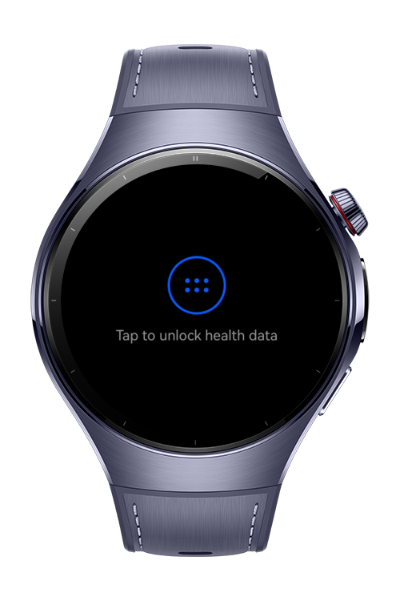
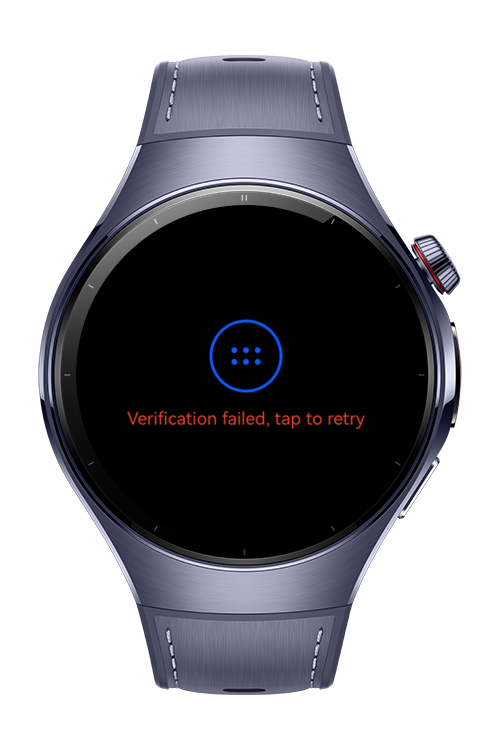

> **Note:** To access all shared projects, get information about environment setup, and view other guides, please visit [Explore-In-HMOS Index](https://github.com/Explore-In-HMOS/hmos-index).

# BiometricAuthButton (how-to-build-biometric-auth-button)

BiometricAuthButton is a HarmonyOS wearable codelab demonstrating a reusable biometric authentication component built on the system-provided `UserAuthIcon` (rendering + tap-triggered auth flow) and the companion `userAuthIcon` module (styling and behavior configuration). The codelab applies the component to a secure health data viewer: tapping the icon triggers on-device biometric verification (fingerprint, face, or PIN fallback) before revealing sensitive health records — blood pressure history, medication schedule, and emergency contacts. The icon automatically adapts to whichever authentication method is actually enrolled on the device.

# Preview

<div>
  
  
</div>

# Use Cases

* Tap the `UserAuthIcon` to trigger the device's built-in biometric authentication flow.

* Automatically render the correct icon (fingerprint, face, or PIN badge) based on the auth method enrolled on the device.

* Configure icon size, color, and auth type preference through the `userAuthIcon` module.

* Reveal the health data view only after a successful authentication result.

* Show inline failure feedback and allow immediate retry on failed or cancelled authentication.

* View blood pressure history, medication schedule, and emergency contacts once unlocked.

* Automatically re-lock the health data view after inactivity or when the app is backgrounded.

# Technology

## Stack
**Languages**: ArkTS

**Frameworks**: HarmonyOS SDK 6.0.1(21)

**Tools**: DevEco Studio

**Libraries**:
`@ohos.userIAM.userAuth`

## Required Permissions
* `"ohos.permission.ACCESS_BIOMETRIC"`

# Directory Structure
```
entry/src/main/ets/
├── entryability/
│   └── EntryAbility.ets                 # Main entry ability of the wearable app
├── entrybackupability/
│   └── EntryBackupAbility.ets           # Backup ability for restore scenarios
│
├── model/
│   └── HealthData.ets                   # BpReading / Medication / EmergencyContact models + mock data
│
├── pages/
│   └── Index.ets                        # Root entry page, hosts AuthGateView and triggers re-lock on page hide
│
├── common/
│   ├── AuthState.ets                    # Locked / authenticating / unlocked / failed state enum
│   └── SessionGuard.ets                 # Inactivity timeout + forced re-lock notifier
│
├── components/
│   ├── UserAuthIcon.ets                 # UserAuthIcon component + userAuthIcon config module (size, color, authType, callbacks)
│   ├── AuthGateView.ets                 # Auth state machine: locked icon <-> unlocked health data view
│   ├── HealthDataView.ets               # Container for the three health data panels
│   └── panels/
│       ├── BloodPressureHistoryPanel.ets
│       ├── MedicationSchedulePanel.ets
│       └── EmergencyContactsPanel.ets

```

# Constraints and Restrictions

## Supported Device
- Huawei Watch 5 (HarmonyOS wearable, circular/rectangular)

## Limitations
- Requires a device/emulator with at least one biometric method (fingerprint or face) enrolled, or system PIN configured, to complete the authentication flow. Without any enrolled method, `UserAuthIcon` falls back to the PIN glyph.
- Health data (blood pressure history, medication schedule, emergency contacts) is local mock data — no backend or cloud sync is implemented.
- `@ohos.userIAM.userAuth` call signatures should be verified against your installed HarmonyOS SDK version, as this API has evolved across API levels.

# License

This project is distributed under the terms of the **MIT License**.
See the [LICENSE](LICENSE) for more information.
